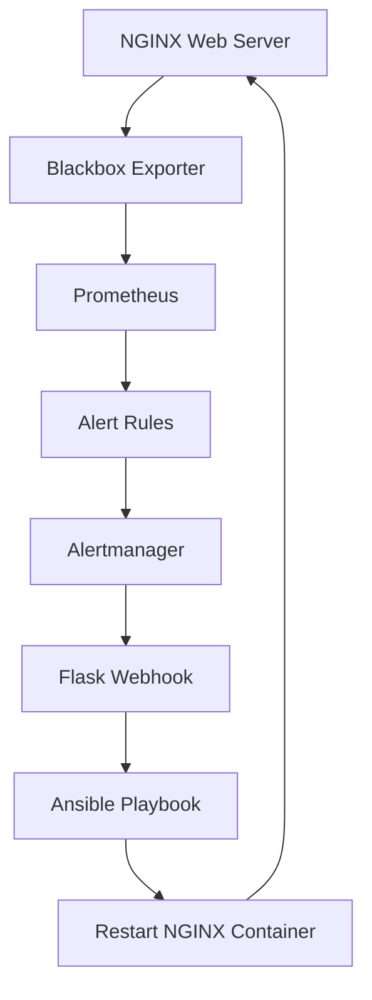

# Self-Healing Infrastructure using Prometheus, Alertmanager & Ansible

## Project Overview

This project implements a self-healing infrastructure system that automatically detects service failures, generates alerts, and attempts automated recovery without manual intervention.

It uses Prometheus for monitoring, Blackbox Exporter for HTTP health checks, Alertmanager for alert routing, a Flask webhook for alert processing, and Ansible for automated service recovery.

## Architecture



## Technology Stack

| Technology | Purpose |
|---|---|
| Docker Compose | Container orchestration |
| NGINX | Sample web application |
| Prometheus | Infrastructure monitoring |
| Blackbox Exporter | HTTP endpoint monitoring |
| Alertmanager | Alert management and routing |
| Flask | Webhook receiver |
| Ansible | Automated recovery |
| Python | Webhook application |
| Linux | Host environment |

## How It Works

1. NGINX runs as a Docker container.
2. Blackbox Exporter periodically checks the NGINX HTTP endpoint.
3. Prometheus collects probe results.
4. If NGINX becomes unreachable for 30 seconds, Prometheus fires the `NginxDown` alert.
5. Alertmanager forwards the alert to the Flask webhook.
6. Flask checks the alert name and status.
7. Flask executes the Ansible recovery playbook.
8. Ansible restarts the NGINX container.
9. A 120-second cooldown prevents repeated recovery attempts.

## Project Structure

```text
self-healing-infrastructure/
├── alertmanager/
│   └── alertmanager.yml
├── ansible/
│   ├── inventory.ini
│   └── recovery.yml
├── blackbox/
│   └── blackbox.yml
├── logs/
│   └── recovery.log
├── prometheus/
│   ├── prometheus.yml
│   └── alert_rules.yml
├── webhook/
│   ├── app.py
│   ├── Dockerfile
│   └── requirements.txt
├── docker-compose.yml
└── README.md
```

## Prerequisites

- Linux system
- Docker Engine
- Docker Compose plugin
- Git

## Installation and Setup

Clone the repository:

```bash
git clone <https://github.com/RAkSHITH256/self-healing-infrastructure.git>
cd self-healing-infrastructure
```

Build and start the services:

```bash
docker compose up -d --build
```

Check running containers:

```bash
docker compose ps
```

## Access the Services

| Service | URL |
|---|---|
| NGINX | http://localhost:8085 |
| Prometheus | http://localhost:9090 |
| Alertmanager | http://localhost:9093 |
| Flask Webhook | http://localhost:5001 |

## Testing Automatic Recovery

Check NGINX:

```bash
curl -I http://localhost:8085
```

Simulate a failure:

```bash
docker stop nginx-app
```

Wait for Prometheus to detect the failure and Alertmanager to send the alert.

Check whether NGINX has recovered:

```bash
docker compose ps
```

Verify the recovery logs:

```bash
tail -30 logs/recovery.log
```

## Testing the Recovery Cooldown

Send a simulated firing alert:

```bash
curl -X POST http://localhost:5001/alerts \
-H "Content-Type: application/json" \
-d '{"alerts":[{"status":"firing","labels":{"alertname":"NginxDown"}}]}'
```

Expected first response:

```json
{"message":"Recovery successful"}
```

Immediately send the same request again.

Expected second response:

```json
{"message":"Recovery skipped: cooldown active"}
```

## Monitoring and Verification

Prometheus targets:

http://localhost:9090/targets

Useful Prometheus query:

```promql
probe_success{job="nginx"}
```

- `1` means the HTTP probe succeeded.
- `0` means the HTTP probe failed.

Recovery logs:

```bash
cat logs/recovery.log
```

## Key Features

- Automated HTTP health monitoring
- Failure detection using Prometheus
- Alert routing using Alertmanager
- Flask-based webhook integration
- Automated recovery using Ansible
- Docker container restart automation
- 120-second recovery cooldown
- Recovery execution logs

## Security Considerations

This is a local learning and demonstration project.

The webhook container has access to the host Docker socket. This grants powerful control over the Docker daemon and should not be exposed to untrusted users or deployed as-is in production.

The Flask development server should also be replaced with a production WSGI server for production deployments.

## Future Enhancements

- CPU and memory threshold-based recovery
- Email or Telegram notifications
- Recovery failure notifications
- Grafana dashboards
- Persistent cooldown state
- Recovery metrics and observability
- Production-grade webhook deployment
